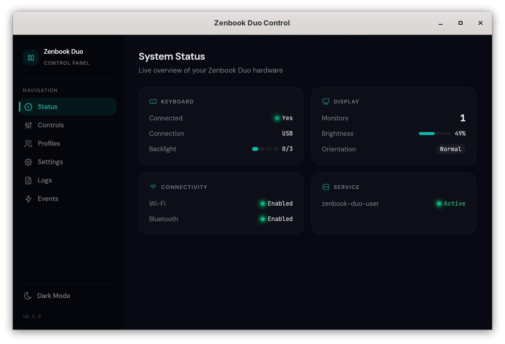

# Linux for the ASUS Zenbook Duo

Makes the Zenbook Duo's detachable keyboard and two screens work properly on Linux: the bottom screen turns on when you take the keyboard off and off when you put it back, and rotation, brightness, backlight and hotkeys keep working over USB and Bluetooth, through sleep, lock and reboot.



## Does it support my laptop?

| Model | Status |
|-------|--------|
| Zenbook Duo 2024 (UX8406MA) | Supported |
| Zenbook Duo 2025 (UX8406CA) | Supported |
| Zenbook Duo 2026 (UX8407AA) | Supported after [extra kernel and firmware setup](#zenbook-duo-2026-ux8407aa-setup) |

- **Desktops:** GNOME (Wayland), KDE Plasma (Wayland), niri and Hyprland. One install covers every one of these desktops on the machine; it follows whichever you log into.
- **Distros:** anything with `dnf` (Fedora), `apt` (Debian, Ubuntu) or `pacman` (Arch, CachyOS).
- **Not supported:** X11 sessions, other compositors, and atomic distros such as Bazzite or Silverblue. Airplane mode is not handled.

## Install or update

You need `systemd`, the Rust toolchain (`cargo`, the runtime is built on your machine), internet access and your sudo password. Run this from a terminal inside your desktop session:

```bash
curl -fsSL https://raw.githubusercontent.com/zakstam/zenbook-duo-linux/main/install.sh | bash
```

It asks for a default keyboard backlight level (0-3), a screen scale (1, 1.25, 1.33, 1.5, 1.67 or 2; default 1.67) and whether to turn on the USB media keys, then builds and installs everything, including the **Zenbook Duo Control** app. After the first install, log out and back in once. To update, run the same command again.

Options (add after `bash -s --`, e.g. `... | bash -s -- --skip-ui`):

- `--skip-ui`: don't install the Control app.
- `--no-usb-media-remap`: leave the USB media keys off by default.

If it can't tell which desktop you're on, clone the repo and run the setup script for your desktop: `./setup-gnome.sh`, `./setup-kde.sh`, `./setup-niri.sh` or `./setup-hyprland.sh`.

### What it changes on your system

- Installs `usbutils`, `iio-sensor-proxy` and your desktop's display tool (`gdctl`, `kscreen-doctor`, `niri msg` or `hyprctl`).
- Adds a udev rule so your logged-in user can read the Duo keyboard (`/etc/udev/rules.d/90-zenbook-duo-keyboard.rules`).
- Adds one sudoers file, `/etc/sudoers.d/zenbook-duo`, allowing the exact screen-brightness writes it needs.
- Installs two system services (`zenbook-duo-rust-daemon`, `zenbook-duo-rust-lifecycle`) and one user service (`zenbook-duo-session-agent`).
- Keeps your settings in `~/.config/zenbook-duo`.

## What it does

- Switches between one and two screens when the keyboard is attached or removed, over USB or Bluetooth.
- Auto-rotates the screens. Laying the Duo flat with both screens up turns only the top screen around for the person opposite.
- Keeps brightness in sync between the screens and handles the keyboard backlight and brightness keys, including over Bluetooth. **Controls → Display Brightness** in the Control app sets each screen on its own, or both together.
- Optionally turns the top row into media keys when docked (F1-F3 volume, F4 backlight, F5/F6 brightness, F11 emoji).
- On the UX8406MA keyboard, **Fn+Esc** switches the top row between media keys and F1-F12, docked and detached; hold Fn for the other one. The setting is under **Controls → Function Keys** in the Control app. The ASUS key (F12) opens the Control app.
- Lets you turn touch off per screen (e.g. pen-only on the bottom screen), remembered across reboots.
- The **Zenbook Duo Control** app (app menu, or `zenbook-duo-control`) shows status and lets you change layout, scale, profiles, settings, and see logs.

## Zenbook Duo 2026 (UX8407AA) setup

The stock kernel and firmware have bugs on this model that you must fix first. This was tested on CachyOS with KDE Plasma and a patched 7.2-rc5 kernel. The project handles the upside-down top panel itself; you only need the steps below.

1. **Patch the kernel.** Take the Port B TCSS power patch (fixes the freeze, and the bottom screen staying off after detaching) and the ghost RT722 patch (fixes no audio) from [zenbook-duo26-Ubuntu26.04](https://github.com/therealarnold666/zenbook-duo26-Ubuntu26.04). Use only its patches, not its installer. On Arch-based distros, add them to your kernel PKGBUILD's `source` array, rebuild, and hold the kernel back from updates (`IgnorePkg` in `/etc/pacman.conf`).
2. **Add to the kernel command line:**
   ```
   video=eDP-1:panel_orientation=upside_down xe.enable_psr=0 xe.enable_psr2_sel_fetch=0 xe.enable_panel_replay=0 xe.enable_dpcd_backlight=3
   ```
   This turns the boot console the right way up, avoids flicker and hangs, and makes brightness work. Do not add `xe.enable_dsb=0`, as it causes flicker on wake.
3. **Auto-rotation firmware.** The stock `ish_ptl.bin` fails to load (`ISH loader: cmd 2 failed` in `dmesg`). Extract the ASUS-signed ISH firmware from ASUS's Windows "Intel Integrated Sensor Solution Driver" package and install it as `/usr/lib/firmware/intel/ish/ish_ptl.bin.zst`, keeping a backup of the original. Reboot. `accel_3d` should then appear under `/sys/bus/iio/devices/`. Firmware package updates put the broken file back, so re-apply it afterwards, or automate that with a package-manager hook.
4. **KDE rotation.** Turn on **Settings → Flip sensor left/right** in the Control app. In System Settings → Display & Monitor, set Screen Rotation to **Manual** on both screens so KDE's own auto-rotate doesn't fight this one. The top screen showing "Rotated 180°" there is correct; leave it.
5. **Upside-down login screen.** Once your session looks right, copy its display config to the login screen:
   ```bash
   sudo install -Dm644 -o sddm -g sddm ~/.config/kwinoutputconfig.json /var/lib/sddm/.config/kwinoutputconfig.json
   ```
   If you use `plasmalogin` instead of SDDM, use `/var/lib/plasmalogin/.config/kwinoutputconfig.json` and `plasmalogin:plasmalogin`.

## Troubleshooting

**Nothing happens when docking or undocking.** Check that both services are running and watch the log:

```bash
systemctl status zenbook-duo-rust-daemon.service
systemctl --user status zenbook-duo-session-agent.service
journalctl -u zenbook-duo-rust-daemon.service -f
```

The Control app's **Logs** and **Events** pages show the same information.

**Wrong layout after login, unlock or resume.** Rerun the installer from inside your desktop session, then log out and back in once.

**F1-F12 don't work while docked.** On the UX8406MA keyboard, press Fn+Esc. On other keyboards, with the USB media keys on, `Fn` gives plain F-keys only if the keyboard reports `Fn` over USB, and many don't. Instead, bind `zenbook-duo-control --toggle-remap-pause` to a shortcut (or use **Pause** in the app): while paused the top row sends plain F1-F12.

**Fn layer broken after upgrading from an old version.** Remove the old key remap:

```bash
sudo rm -f /etc/udev/hwdb.d/90-zenbook-duo-keyboard.hwdb
sudo systemd-hwdb update
sudo udevadm trigger
```

If none of this helps, [open an issue](https://github.com/zakstam/zenbook-duo-linux/issues) with your model, distro, desktop and the daemon log.

## Uninstall

```bash
git clone https://github.com/zakstam/zenbook-duo-linux.git
cd zenbook-duo-linux
./uninstall.sh
```

This removes the services, rules, sudoers file, the Control app and your settings. Add `--keep-ui` to keep the app or `--keep-config` to keep `~/.config/zenbook-duo`.

Older versions added you to the `input` group, which is no longer needed. To remove that: `sudo gpasswd -d "$USER" input`.

## Contributing

Developer notes, checks and architecture are in [AGENTS.md](AGENTS.md).
