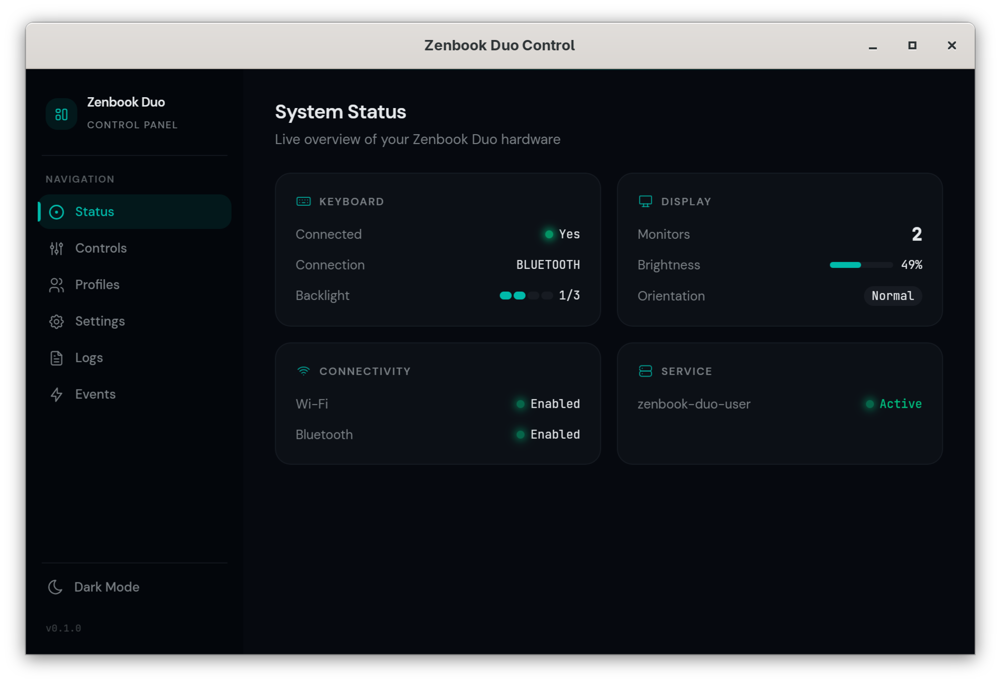

# Linux for the ASUS Zenbook Duo

Linux support tooling for the ASUS Zenbook Duo. The project installs a Rust hardware runtime plus an optional Tauri/React Control Panel so the detachable keyboard, dual displays, rotation, brightness, backlight, hotkeys, touchscreen controls, and related laptop behavior keep working across USB/Bluetooth attach and detach, boot, resume, lock, and desktop-session transitions.

This is intentionally device-specific. The goal is a dependable Zenbook Duo experience on the supported Linux desktop matrix, not a generic dual-screen laptop framework.

## What it does

- Detects the Zenbook Duo keyboard over USB and Bluetooth.
- Switches between docked and tablet-style display layouts when the keyboard is attached or removed.
- Keeps keyboard backlight, display brightness, Bluetooth/Wi-Fi restore behavior, rotation, and saved settings coordinated through a Rust daemon.
- Provides USB media remapping for Zenbook Duo top-row keys, including mute/volume, brightness, keyboard backlight cycling, and emoji launcher behavior where supported.
- Auto-rotates the screens from the accelerometer. Laying the Duo opened flat on a table (both screens facing up) turns only the top screen around for the person opposite, as Windows does; picking it up rotates normally again.
- Handles Bluetooth backlight and brightness hotkeys through the daemon.
- Supports per-display touchscreen enable/disable for the built-in ELAN panels, persisted across reboot/resume.
- On GNOME, maps Duo touch and stylus input to the matching internal panel so touch targets the correct screen.
- Provides a Control Panel for status, display layout, controls, profiles, settings, logs, events, and diagnostics.

Known boundaries:

- Supported hardware target: ASUS Zenbook Duo.
- Supported desktop backends: GNOME Wayland, KDE Plasma Wayland, Hyprland, and Niri.
- X11 and other compositors are not first-class targets.
- Some vendor-specific keys, such as airplane mode and ASUS software keys, are not implemented by this project.
- Per-panel touch-to-output mapping is currently automatic on GNOME only; KDE and Niri need backend-specific support before this can be enabled safely.

## Quick start

### Requirements

- ASUS Zenbook Duo. The 2026 model (UX8407AA, keyboard `0b05:1cd7`) needs extra setup first; see [ASUS Zenbook Duo 2026 (UX8407AA)](#asus-zenbook-duo-2026-ux8407aa).
- GNOME on Wayland, KDE Plasma on Wayland, Hyprland, or Niri.
- `systemd` with working system and user service managers.
- A supported package-manager family for automatic setup: `dnf`, `apt`, or `pacman`.
- Rust toolchain with `cargo` available; the runtime is built locally during install.
- A terminal, internet access, and your sudo/admin password.

### One-line install or update

```bash
curl -fsSL https://raw.githubusercontent.com/zakstam/zenbook-duo-linux/main/install.sh | bash
```

`install.sh` detects GNOME, KDE Plasma, Hyprland, or Niri, runs the matching setup wrapper, installs the Rust runtime services, and then builds/installs the Control Panel unless you opt out.

Useful one-line variants:

```bash
curl -fsSL https://raw.githubusercontent.com/zakstam/zenbook-duo-linux/main/install.sh | bash -s -- --skip-ui
curl -fsSL https://raw.githubusercontent.com/zakstam/zenbook-duo-linux/main/install.sh | bash -s -- --no-usb-media-remap
```

The same options work from a local checkout:

```bash
./install.sh --skip-ui              # install/update only the runtime services
./install.sh --no-usb-media-remap   # leave USB media remap disabled by default
sudo -E ./install.sh                # allowed, but a real sudo user session is required
```

After a fresh install, log out and back in so group membership and session environment changes take effect. If you are only updating and something looks stale, restart the user session agent:

```bash
systemctl --user restart zenbook-duo-session-agent.service
```

### Local checkout install

```bash
git clone https://github.com/zakstam/zenbook-duo-linux.git
cd zenbook-duo-linux
./install.sh
```

If desktop auto-detection fails, run the matching setup wrapper directly:

```bash
./setup-gnome.sh
# or
./setup-kde.sh
# or
./setup-hyprland.sh
# or
./setup-niri.sh
```

The setup wrappers install the runtime services. To build or update only the Control Panel app, run:

```bash
./install-ui.sh
```

On desktop sessions, the UI installer prefers a graphical admin-password prompt for system install steps and falls back to terminal `sudo` when needed.

## Control Panel

Screenshots:




The Control Panel can be launched from your app menu as **Zenbook Duo Control**, or from a terminal:

```bash
zenbook-duo-control
```

Main pages:

- **Status** — live keyboard, display, connectivity, service, version, and USB-remap status.
- **Displays** — connected display layout, scale, refresh mode where available, and mapped touchscreen toggles.
- **Controls** — keyboard backlight, orientation, service restart, and touchscreen toggles.
- **Profiles** — save and activate common hardware configurations.
- **Settings** — defaults such as backlight, scale, theme, start-on-boot, rotation inversion, and USB media remap.
- **Logs / Events** — runtime log output and recent hardware/service events.
- **Diagnostics** — evdev, HID, report descriptor, and hidraw capture helpers for debugging hardware behavior.

## Installed components

The installer/setup scripts make system-level changes because the project controls hardware and desktop-session behavior:

- Installs common dependencies: `usbutils`, `iio-sensor-proxy`, and `systemd`.
- Installs backend dependencies:
  - GNOME: `mutter` / `gdctl` and `dconf` for touch/stylus output mapping
  - KDE Plasma: `kscreen` / `kscreen-doctor`
  - Hyprland: `hyprland` (provides `hyprctl`)
  - Niri: `niri`
- Adds the target user to the `input` group. Log out/in after first install.
- Installs a udev rule for the Zenbook Duo keyboard.
- Removes the old Zenbook Duo hwdb remap if present because it breaks the USB Fn layer.
- Adds the sudoers entry needed for brightness writes used by the session agent.
- Installs Rust runtime binaries under `/usr/local/libexec/zenbook-duo`.
- Installs/enables these services:
  - `zenbook-duo-rust-daemon.service` — system daemon and hardware authority.
  - `zenbook-duo-rust-lifecycle.service` — boot/shutdown and sleep lifecycle hook.
  - `zenbook-duo-session-agent.service` — per-user session agent for compositor/session actions.
- Stores user settings under `~/.config/zenbook-duo`.

## GNOME extension

On GNOME, setup asks whether to install **Zenbook Duo Snap**, a GNOME Shell extension for the two screens (`--gnome-extension` / `--no-gnome-extension` answer up front). It is copied to `~/.local/share/gnome-shell/extensions/zenbook-duo-snap@zenbook-duo-linux` and enabled; it loads after you log out and back in.

- **Snap while dragging**: when you start dragging a window (mouse or finger), a popup opens next to the pointer with layouts for the top screen, the bottom screen, both screens stretched together, and any connected external screens: full, free (the window's own size, centred), halves, stacked, thirds, and quarters. Drop on a cell to place the window there. Screens that are off are greyed out.
- **Tiled windows resize together**: dragging the edge between two snapped windows moves the whole dividing line. Dragging a snapped window away gives it back its earlier size.
- **Swap screens**: `XF86Launch2` (the screen-arrows key, `F8`) swaps the windows of two screens; `Shift+XF86Launch2` moves the focused window to another screen. With exactly two screens on (both panels, or a panel and an external screen) this happens directly; with more, a dialog shows a map of the screens to pick the two to swap (it remembers the last pair) or the target screen. The keys can be changed in the extension's settings (`gsettings` schema `org.gnome.shell.extensions.zenbook-duo-snap`).
- **On-screen keyboard**: opens only when you tap a text field with your finger (not for mouse or touchpad), and on the Duo panels never while the keyboard is attached: on the bottom screen, or on the top screen when the keyboard would cover the field. Swiping up to open it only works from the bottom edge of the bottom screen. On an external touch screen it opens on that screen, for taps and swipes, also with the keyboard attached.
- **Display controls**: the display key (`F7`, which the keyboard sends as `Super+P`) opens a compact Displays dialog on the main display, and closes it again (setting `display-controls-on-super-p`; turning it off gives `Super+P` back to GNOME). Changes apply right away, in three tabs:
  - *Projection*: show everything, the Duo only, or the external screens only; per screen on/off and main display; an external screen can show its own desktop or mirror a Duo panel or another external screen (both switch to a resolution they share). *Table mode* turns the top screen upside down for someone across the table, with the bottom screen as the main display (slides on top, the presenter view below); auto-rotation pauses meanwhile. With the keyboard attached the bottom screen can't be turned on here.
  - *Position*: place an external screen above, left, right or below the Duo, one panel, or another external screen, with an offset along that edge: centred, halfway, as far as GNOME allows (10% of the shorter edge stays shared so the pointer can cross), or with the edges lined up. Choices that would overlap another screen are greyed out; screens placed against another one move along with it.
  - *Screen*: rotation for external screens, the scale (the panels' scale is saved like the Control Panel's), and each Duo panel's brightness, with a *Both Duo screens* toggle.
- **Main display switch**: `Shift+F7`, or five fingers held still on a touch screen for a moment, shows a bubble on every screen: press *Make this the main display* on the one you want; pressed again, it is cancelled. The keyboard drops Shift for `F7` and sends `Super+P`, so `Shift+F7` needs the Zenbook Duo services to recognise it (settings `main-display-switch`, `five-finger-main-display`).
- **Warnings**: when the bottom screen is on while the keyboard lies on it (turned on in GNOME Settings, say), a bubble offers to turn it off, which moves its windows to the top screen. With the Zenbook Duo services, low keyboard battery shows as a bubble that stays until you press OK.
- **Pop-ups**: provides on-screen pop-ups, like GNOME's volume and brightness ones, that the Zenbook Duo services use when they are installed (Fn lock, keyboard backlight, mic volume, the screen key, attach and detach).

It targets GNOME 50. Stretching a window across both screens relies on Ubuntu's Mutter (which lets the extension mark the window as tiled so GTK 4 apps keep the size); elsewhere it still places the window but some apps may shrink back to one screen.

If the extension ever misbehaves, turn it off with `gnome-extensions disable zenbook-duo-snap@zenbook-duo-linux`. `uninstall.sh` removes it.

## Architecture snapshot

- **Rust system daemon**: owns hardware state, policy, persistence, privileged operations, logs/events, Bluetooth hotkeys, and daemon IPC.
- **Rust session agent**: runs in the user session and executes compositor-bound work such as GNOME/KDE/Hyprland/Niri display changes, brightness sync watchers, rotation handling, and desktop notifications.
- **Tauri/React Control Panel**: client UI for status, controls, settings, profiles, logs, events, and diagnostics. It should use daemon/session APIs instead of owning hardware policy itself.
- **Bash installers**: keep install/update simple while centralizing shared setup behavior in `setup-common.sh` and keeping desktop wrappers thin.

## Supported matrix

Desktop backends:

| Desktop backend | Setup wrapper | Display command |
|-----------------|---------------|-----------------|
| GNOME on Wayland | `setup-gnome.sh` | `gdctl` |
| KDE Plasma on Wayland | `setup-kde.sh` | `kscreen-doctor` |
| Hyprland | `setup-hyprland.sh` | `hyprctl` |
| Niri | `setup-niri.sh` | `niri msg` |

The Hyprland backend owns only the two internal Duo panels discovered through DRM eDP metadata. External outputs are inspected but never reconfigured. Systems with nonstandard internal connector names can set `ZENBOOK_DUO_UPPER_CONNECTOR` and `ZENBOOK_DUO_LOWER_CONNECTOR` in the session-agent service environment.

Package-manager families used by the automated setup paths:

| Distro family | Package manager |
|---------------|-----------------|
| Fedora / RHEL-based | `dnf` |
| Debian / Ubuntu-based | `apt` |
| Arch / CachyOS | `pacman` |

Other distributions may be possible with manual dependency installation and script adaptation, but they are not automated by the current setup flow.

## Troubleshooting

### Nothing happens when docking or undocking

Check both services:

```bash
systemctl status zenbook-duo-rust-daemon.service
systemctl --user status zenbook-duo-session-agent.service
```

Watch daemon logs:

```bash
journalctl -u zenbook-duo-rust-daemon.service -f
```

Also check the Control Panel **Logs**, **Events**, and **Diagnostics** pages.

### Reboot, login, unlock, or resume comes up in the wrong layout

The lifecycle service and session agent should re-sync the current attached/detached state after boot, login, resume, and unlock. If they do not:

```bash
systemctl --user status zenbook-duo-session-agent.service
systemctl --user show-environment | grep -E 'DISPLAY|WAYLAND_DISPLAY|NIRI_SOCKET|HYPRLAND_INSTANCE_SIGNATURE|XDG_CURRENT_DESKTOP|XDG_SESSION_DESKTOP|DESKTOP_SESSION|XDG_SESSION_TYPE'
```

An early `No supported session backend became ready before timeout; continuing to wait` warning is OK if the session agent remains active. If desktop-session environment variables are missing after reinstalling, rerun `./install.sh` from an active desktop session, then log out and back in once.

### Keyboard media or Fn keys stop working after suspend or reattach

The optional USB media remap helper is stopped before sleep and retried after resume. If recovery still fails, check daemon logs for `USB media remap auto-start failed` or repeated `No such device` messages:

```bash
journalctl -u zenbook-duo-rust-daemon.service -f
```

You do not need a separate `/etc/udev/rules.d/*uinput*` rule for this project.

### USB top row and the Fn layer

When docked over USB, the optional USB media remap turns the top row into media keys (F1-F3 volume, F4 backlight, F5/F6 brightness, F11 emojis). Holding `Fn` sends plain `F1`-`F12` only if the keyboard reports the Fn key over USB. The remap logs which case applies when it starts: look for `Fn key reported by` or `No keyboard node reports the Fn key` in `/run/user/$UID/zenbook-duo/duo.log`.

If Fn is not reported, use pause as an Fn-lock: bind `zenbook-duo-control --toggle-remap-pause` to a desktop shortcut (or use the Pause button in the app). While paused the top row sends plain `F1`-`F12`, and you get a notification on each toggle.

Do not install hwdb remaps for `KEYBOARD_KEY_7003*` on USB; it overrides the Fn layer.

### Keyboard backlight scanning loops

If you see repeated `KBLIGHT - Device lost, re-scanning` messages, log out and back in so your session picks up the `input` group membership.

### USB Fn layer is broken after upgrading from an older install

Remove the old hwdb remap and retrigger udev:

```bash
sudo rm -f /etc/udev/hwdb.d/90-zenbook-duo-keyboard.hwdb
sudo systemd-hwdb update
sudo udevadm trigger
```

The current setup scripts also remove that file automatically.

## ASUS Zenbook Duo 2026 (UX8407AA)

The 2026 model (Intel Core Ultra "Panther Lake", Intel Arc iGPU on the `xe` driver, keyboard USB ID `0b05:1cd7`) works with this project, but the stock kernel and firmware have several bugs that must be fixed first. Verified on CachyOS + KDE Plasma on Wayland with a patched 7.2-rc5 kernel. The kernel patches come from [zenbook-duo26-Ubuntu26.04](https://github.com/therealarnold666/zenbook-duo26-Ubuntu26.04) (an Ubuntu-targeted derivative of this project) — use its patches, but do not run its installer on non-Ubuntu distros; run this project's installer instead.

This project detects the UX8407AA via DMI (`/sys/class/dmi/id/board_name`) and automatically compensates for its upside-down top panel in the KDE display backend, so no code changes are needed — only the system-level steps below.

### 1. Kernel patches — keyboard-detach freeze and audio

This project does not ship these patches; get them from [zenbook-duo26-Ubuntu26.04](https://github.com/therealarnold666/zenbook-duo26-Ubuntu26.04).

- **Detach freeze / bottom screen never re-enables**: the Port B C20 TCSS PHY loses its power ack when eDP-2 is toggled. Fix: the DMI-gated Port B TCSS power patch (i915/xe shared display code) from that repo.
- **No audio** (`aplay -l` shows no cards): a ghost RT722 SoundWire device makes `sof_sdw` probing fail with `-EEXIST` (duplicate `SDW3-Playback-SimpleJack`). Fix: the ghost RT722 patch from that repo (adds UX8407AA to the SoundWire DMI ghost-device quirk table).

Both apply cleanly to kernel 7.2-rc5. On Arch-based distros, append the patch files to your kernel PKGBUILD's `source` array (with `SKIP` checksums) and rebuild; then pin the patched kernel (e.g. `IgnorePkg` in `/etc/pacman.conf`) so an update does not replace it before the fixes land upstream.

### 2. Kernel command line

Add to your bootloader's kernel command line:

```
video=eDP-1:panel_orientation=upside_down xe.enable_psr=0 xe.enable_psr2_sel_fetch=0 xe.enable_panel_replay=0 xe.enable_dpcd_backlight=3
```

- `video=eDP-1:panel_orientation=upside_down` — the top panel is physically mounted 180° and there is no upstream DRM quirk yet; this fixes the console/LUKS-prompt orientation.
- `xe.enable_psr=0 xe.enable_psr2_sel_fetch=0 xe.enable_panel_replay=0` — avoids PSR/panel-replay flicker and hangs on Panther Lake.
- `xe.enable_dpcd_backlight=3` — enables brightness control (the default backlight path does not work on this panel).
- Do **not** add `xe.enable_dsb=0` on the patched kernel: it forces a slow CPU display path and causes multi-blink flicker on wake from screen-off. It was only ever an interim mitigation for the detach freeze that the Port B TCSS power patch fixes properly.

### 3. Auto-rotation — ASUS ISH firmware

The accelerometer sits behind the Intel ISH, and the mainline `ish_ptl.bin` firmware fails to load on this machine (`ISH loader: cmd 2 failed` in dmesg, no IIO devices). Fix: extract the ASUS-signed ISH firmware from ASUS's Windows "Intel Integrated Sensor Solution Driver" package and install it (compressed) as `/usr/lib/firmware/intel/ish/ish_ptl.bin.zst`, keeping a backup of the mainline blob. After a reboot, `accel_3d` appears under `/sys/bus/iio/devices/` and `iio-sensor-proxy` works.

Note: linux-firmware package updates will restore the broken mainline blob — re-apply the ASUS blob after firmware updates (a pacman/apt post-transaction hook that compares and restores it automates this).

### 4. Rotation settings (KDE)

- Only the top panel (eDP-1) is mounted upside down; the app applies the per-panel 180° offset automatically on UX8407AA.
- Set `"invertSensorRotation": true` in `~/.config/zenbook-duo/settings.json` (or toggle it in the Control Panel UI).
- Set Screen Rotation to **Manual** for both screens in KDE System Settings → Display & Monitor. Otherwise KWin's own tablet-mode auto-rotate (which does not know about the flipped panel) fights this app whenever the keyboard is detached.
- In the KDE session, eDP-1 showing as "Rotated 180°" in display settings is the correct resting state — KWin ignores the kernel `panel_orientation` quirk, so do not manually reset it to normal.

### 5. Login screen orientation

The greeter runs its own KWin instance, which also ignores the panel-orientation quirk, so the login screen appears upside down. Fix: once your session displays correctly, copy your display config into the greeter's home:

```bash
sudo install -Dm644 -o sddm -g sddm ~/.config/kwinoutputconfig.json /var/lib/sddm/.config/kwinoutputconfig.json
```

On installs using `plasmalogin` instead of SDDM (some CachyOS setups), use `/var/lib/plasmalogin/.config/kwinoutputconfig.json` owned by `plasmalogin:plasmalogin`.

## Uninstall

To remove the runtime, services, udev/hwdb rules, sudoers entries, installed files, UI app, and user config:

```bash
./uninstall.sh
```

Options:

```bash
./uninstall.sh --keep-ui      # keep the Control Panel installed
./uninstall.sh --keep-config  # keep ~/.config/zenbook-duo
```

The uninstall script does not remove your user from the `input` group. To do that manually:

```bash
sudo gpasswd -d "$USER" input
```

## Development and maintainer notes

### Runtime, installer, and frontend checks

Use the root check script before changing installer, runtime, or UI behavior:

```bash
./check.sh installers   # shell syntax + installer smoke tests
./check.sh rust         # Rust runtime unit tests
./check.sh frontend     # React/TypeScript production build
./check.sh all          # full compatibility pass
```

Run the narrow target for the area you touched; run `./check.sh all` before handing off broad cross-area changes.

### UI development

```bash
cd ui-tauri-react
npm install
npm run dev
```

Useful build commands:

```bash
npm run build:frontend  # frontend-only production build
npm run build:rust      # Rust-only release build
npm run build:local     # Tauri release build without packaging bundles
npm run build           # full Tauri build with configured bundles
```

### Release version bump

```bash
./bump-version.sh patch    # or minor, major, or an explicit version like 0.3.8
```

The helper updates `package.json`, `package-lock.json`, `Cargo.toml`, `Cargo.lock`, and `tauri.conf.json` together.

### Maintainer checklist

- Keep common installer behavior in `setup-common.sh`; keep desktop wrappers limited to backend-specific packages and manual dependency hints.
- Keep settings defaults aligned across `setup-common.sh`, Rust `DuoSettings::default`, and frontend `DEFAULT_DUO_SETTINGS`.
- Keep the daemon authoritative for hardware state, policy, persistence, privileged operations, and daemon IPC.
- Keep the session agent narrow: compositor/session actions, display commands, brightness/rotation watchers, and user-session notifications.
- Preserve GNOME, KDE, Hyprland, and Niri parity when changing shared behavior.
- Update `tests/install-stdin-test.sh` whenever supported desktops, package managers, service units, defaults, or installer entrypoints change.
